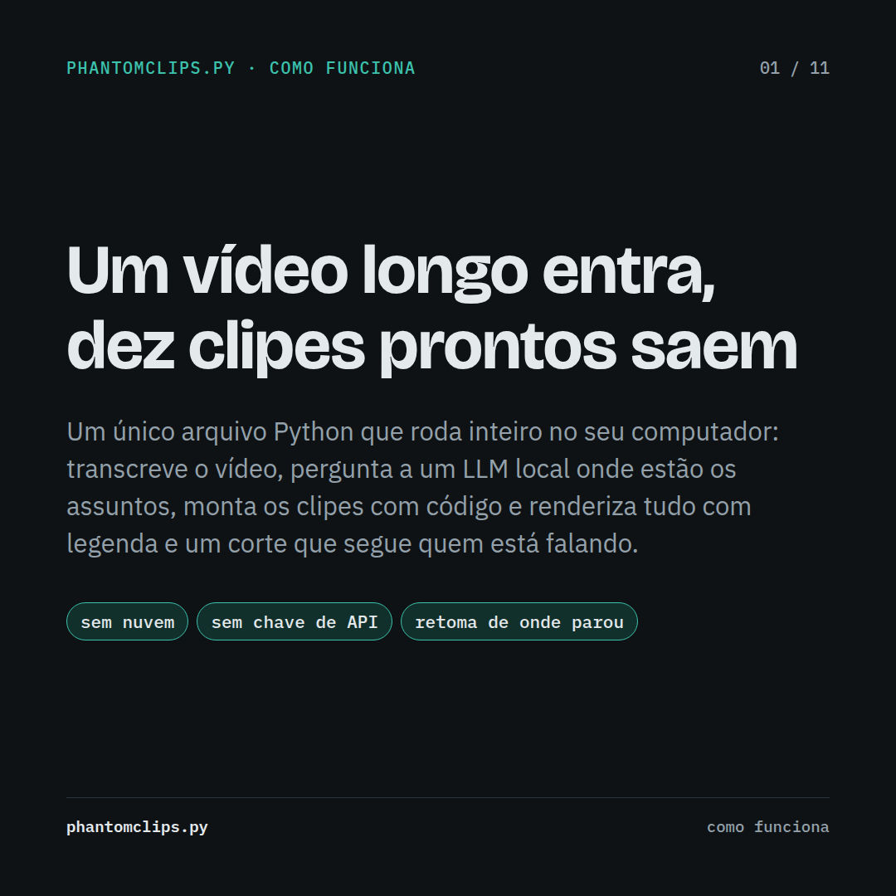
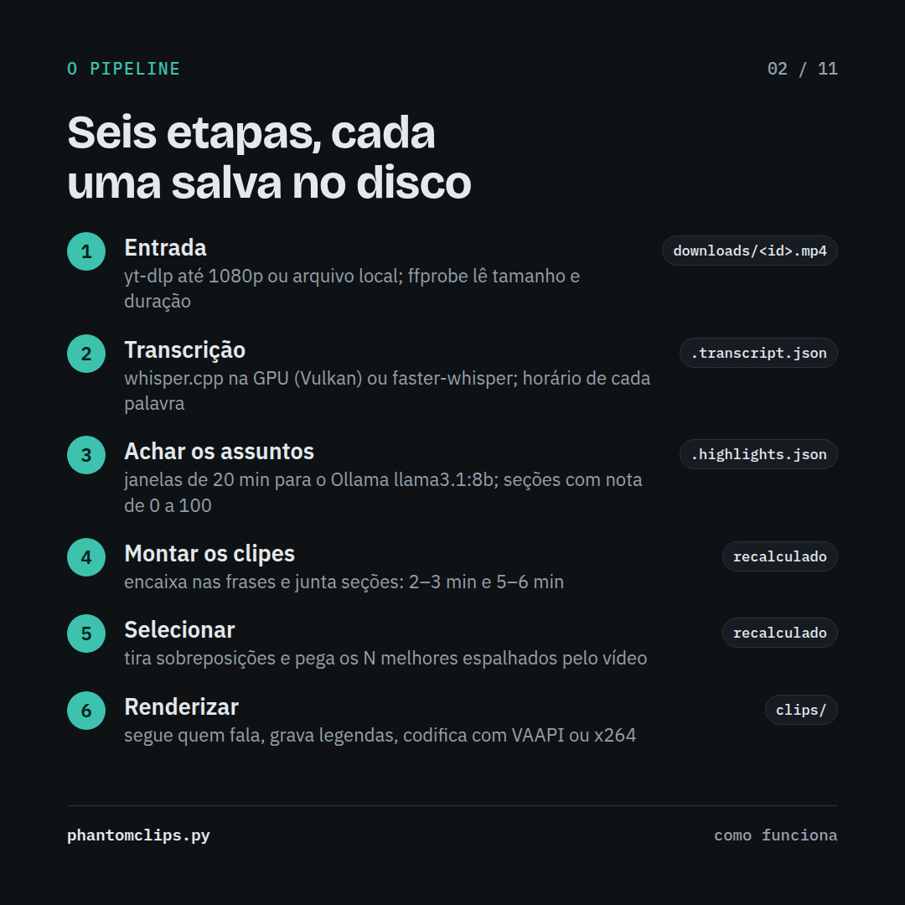
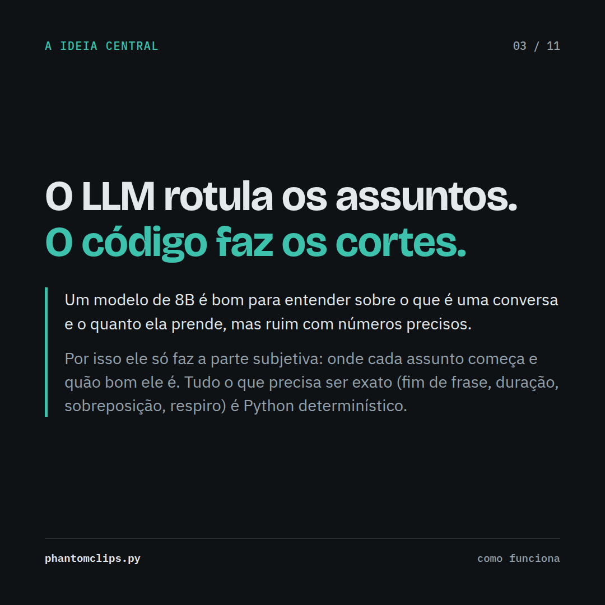
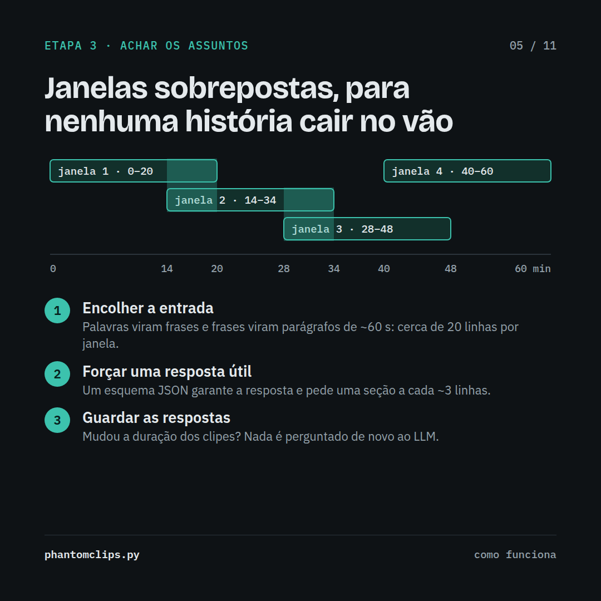
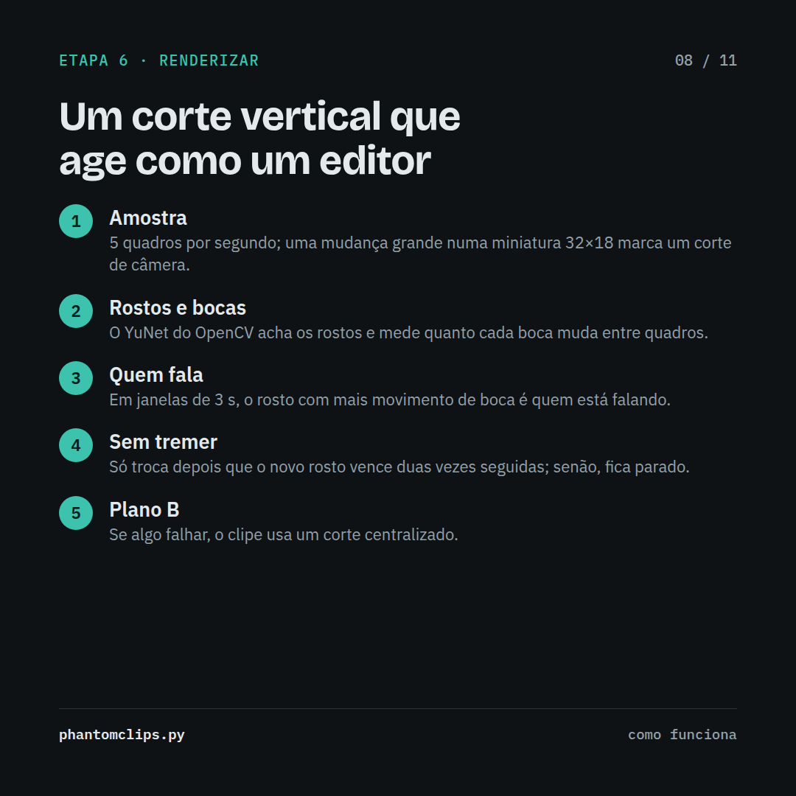

# phantomclips

[English](#english) · [Português (Brasil)](#português-brasil)

---

## English

**Turn one long video into ten ready-to-post clips, fully on your own computer.**
Podcasts, interviews, livestreams, lectures: phantomclips finds the best moments, cuts them
on clean sentence breaks, follows whoever is talking in vertical format, and burns in captions.
No cloud, no API keys, no per-minute fees.

### What you get

- **Vertical clips (2–3 min)** at 1080×1920 for TikTok, Reels and Shorts, with a crop that follows the speaker
- **Landscape clips (5–6 min)** for YouTube, X and LinkedIn
- **Burned-in captions**, sized for each format
- **A title, hook and score** for every clip, chosen by a local AI model
- **Thumbnail kit**: the sharpest speaker frames plus a ready prompt for a free AI thumbnail
- **Resumes where it stopped**, so long videos survive crashes and restarts
- Works with a **YouTube link or a local file**; English, Portuguese, Spanish and more

### How it works

| | |
|---|---|
|  |  |
|  |  |

### Requirements

- Linux or Windows, Python 3.10+, ffmpeg and [Ollama](https://ollama.com)
- Any modern CPU works; an NVIDIA, AMD or Intel GPU makes it much faster
- About 8 GB of RAM for the local AI model

### Get access

The source code is in a private repository, available to sponsors.

1. Choose a tier at **[github.com/sponsors/noxccz](https://github.com/sponsors/noxccz)**.
2. GitHub sends you an invitation to the private repository automatically. Accept it from your email or at [github.com/notifications](https://github.com/notifications).
3. Clone it and follow its setup guide.

You keep receiving updates while your sponsorship is active. The code is for your own use;
the clips you make are yours to post and monetize.

---

## Português (Brasil)

**Transforme um vídeo longo em dez clipes prontos para postar, tudo no seu próprio computador.**
Podcasts, entrevistas, lives, palestras: o phantomclips encontra os melhores momentos, corta
nos finais de frase, segue quem está falando no formato vertical e grava as legendas no vídeo.
Sem nuvem, sem chave de API, sem cobrança por minuto.

### O que você recebe

- **Clipes verticais (2–3 min)** em 1080×1920 para TikTok, Reels e Shorts, com um corte que segue quem fala
- **Clipes horizontais (5–6 min)** para YouTube, X e LinkedIn
- **Legendas gravadas no vídeo**, no tamanho certo para cada formato
- **Título, gancho e nota** para cada clipe, escolhidos por uma IA local
- **Kit de thumbnail**: os quadros mais nítidos de quem fala e um prompt pronto para gerar a thumbnail de graça
- **Continua de onde parou**, então vídeos longos sobrevivem a travamentos e reinícios
- Funciona com **link do YouTube ou arquivo local**; português, inglês, espanhol e outros idiomas

### Como funciona

Veja o carrossel completo em [`images/`](images): 11 slides explicando cada etapa.

### Requisitos

- Linux ou Windows, Python 3.10+, ffmpeg e [Ollama](https://ollama.com)
- Qualquer CPU moderna funciona; uma GPU NVIDIA, AMD ou Intel deixa tudo bem mais rápido
- Cerca de 8 GB de RAM para o modelo de IA local

### Como ter acesso

O código fica num repositório privado, liberado para quem patrocina.

1. Escolha um plano em **[github.com/sponsors/noxccz](https://github.com/sponsors/noxccz)**.
2. O GitHub envia automaticamente um convite para o repositório privado. Aceite pelo e-mail ou em [github.com/notifications](https://github.com/notifications).
3. Clone o repositório e siga o guia de instalação.

Você recebe as atualizações enquanto o patrocínio estiver ativo. O código é para uso
próprio; os clipes que você criar são seus para postar e monetizar.
